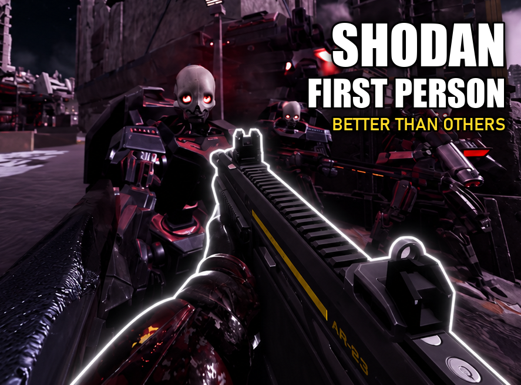

# SHODAN First Person

A first person camera for **Helldivers 2**, with its own in-game settings panel. Every view can be
tuned: on foot, crouched, prone, diving, in a hellpod, driving or riding an FRV, in a tank, a mech or
on an emplacement, and each weapon can have its own setup. Settings save between launches and can be kept
as profiles.

When you die, your view blurs, your eyes blink and close, and the screen goes black until your
reinforcement drops in. Aim with the ballistic shield raised and you look through its window slot.

**[Download the latest release](../../releases/latest)** · Needs Chef Shared Loader 1.5.4 or newer

## Install

1. Install Chef Shared Loader 1.5.4 or newer.
2. Add the SHODAN First Person zip in your mod manager and deploy. Its Death sound option plays a sound when you die.
   It's set to None by default, which keeps the game as it is.
   Its Glass cockpit option turns an exosuit's cockpit to glass while you sit in it. Untick it if you use another
   cockpit mod.
3. Start the game. Press **F6** for first person and **F10** for the settings panel.

## Keys

| Key | What it does |
|---|---|
| F6 | First person on or off |
| F7 | Hold for third person |
| F10 | Open the settings panel |

Every key can be changed on the panel's Keys tab, along with next profile.

## Settings panel

Camera, Aim and Stance open with a weapon list. Pick a weapon to give it its own values, used whenever
it's in your hands.

| Tab | What you can change |
|---|---|
| Camera | Camera position, field of view, aiming field of view, smoothing, profiles, the ballistic shield view, sprint tilt, the death effect and knockdown daze, and when to switch to third person (galactic map, mission terminals, map and stratagem menu) |
| Aim | Crosshair follows the gun: keeps your shots where the crosshair points, while aiming and from the hip |
| Stance | Its own camera position and field of view when crouched or prone, how the view behaves when diving, lying down, knocked down and getting up |
| Meshes | Hide any part of your helldiver from view, the guns in hand or on your back, and armour while scoped |
| FRV | Driver, passenger and gunner seat positions and field of view, how far you can look down and the view when you look back, for each FRV model |
| Tanks | Passenger seat positions and field of view for the Bastion and Maelstrom |
| Mechs | Camera position and field of view for each mech and emplacement, or third person in them, and a glass or fully clear cockpit |
| Keys | Every key the mod uses |

## License

GNU GPL v3.0
